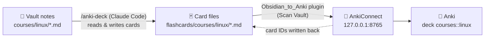

<div align="center">


# ✦ claude-anki-flashcards ✦

Turn the notes of an Obsidian vault into **Anki flashcards**, folder by folder, with [Claude Code](https://claude.com/claude-code).

[](LICENSE)
[](https://claude.com/claude-code)
[](https://obsidian.md)
[](https://apps.ankiweb.net)

```
/anki-deck courses/linux
```

</div>

Claude reads every note in `courses/linux/`, writes flashcards for them into `flashcards/courses/linux/`, and syncs them to an Anki deck named `courses::linux`. Run it again later: only new or modified notes are processed, edited cards are updated in Anki (with their review history kept), and removed cards are deleted.

> [!NOTE]
> **Your notes are never modified.**

---

## How it works



| Piece | Role |
|---|---|
| [Anki](https://apps.ankiweb.net) | Spaced-repetition app where you review the cards |
| [AnkiConnect](https://git.foosoft.net/alex/anki-connect) | Anki add-on that exposes a local API so other programs can add and update cards |
| [Obsidian_to_Anki](https://github.com/marqp/Obsidian_to_Anki) (marqp fork) | Obsidian plugin that sends card files to Anki through AnkiConnect and keeps them in sync |
| `/anki-deck` (this repo) | Claude Code skill that writes the card files from your notes, then triggers the sync |

The plugin cannot *invent* cards: it only syncs cards written in its syntax. Claude does the smart part (deciding what is worth learning and phrasing good questions). The plugin does the mechanical part (IDs, updates, deletions).

---

## Requirements

- [Anki](https://apps.ankiweb.net) desktop, started at least once (tested with 26.09).
- [Obsidian](https://obsidian.md) (1.12+ recommended, for its command line interface).
- [Claude Code](https://claude.com/claude-code).
- Python 3.9+ (standard library only).

Tested on Linux (Arch). The macOS and Windows paths are handled but have not been tested yet: feedback is welcome.

## Installation

```bash
git clone https://github.com/<you>/claude-anki-flashcards.git
cd claude-anki-flashcards
python3 install.py "/path/to/your/vault"
```

The installer is idempotent (safe to run again) and does the following:

1. **AnkiConnect**: downloads the add-on into Anki if it is missing, and adds `app://obsidian.md` to its allowed origins. If Anki is running with the old settings, it asks you to restart Anki and waits for it.
2. **Note types**: asks Anki for your note types and detects the basic, reversed and cloze ones, **whatever the language of your Anki** (`Basic`/`Front`/`Back`, `Basique`/`Recto`/`Verso`, …).
3. **Obsidian plugin**: downloads the latest Obsidian_to_Anki release from the marqp fork into `<vault>/.obsidian/plugins/` and configures it to scan only the `flashcards/` folder. Existing plugin settings are kept (a `data.json.bak` backup is made).
4. **Skill**: copies `/anki-deck` into `<vault>/.claude/skills/anki-deck/`, with a `config.json` holding your note types.

Then:
- If Obsidian was open on another vault, or its CLI is disabled, restart Obsidian and check that **Obsidian_to_Anki** is enabled in *Settings → Community plugins*.
- Recommended: enable *Settings → General → Command line interface* in Obsidian, so that `/anki-deck` can start the sync itself.

Installer options:

| Option | Default | Effect |
|---|---|---|
| `--cards-dir DIR` | `flashcards` | Vault folder that holds the card files |
| `--anki-dir PATH` | auto | Anki data folder (the one that contains `addons21/`) |
| `--plugin-version TAG` | `latest` | Obsidian_to_Anki release to install |
| `--wait SECONDS` | `300` | How long to wait for Anki to (re)start |
| `--skill-only` | | Only reinstall the skill files (keeps your `config.json`) |

---

## Usage

From your vault, in Claude Code:

```
/anki-deck courses/linux              # a folder (subfolders included)
/anki-deck "courses/linux/nvim.md"    # a single note
/anki-deck courses/linux --force      # regenerate notes that are already up to date
/anki-deck courses/linux --no-sync    # write the cards without syncing
```

Plain requests work too: *"make me an Anki deck from courses/biology"*.

What happens:

1. **Status**: each note is compared with its card file:
   - `new`: no cards yet;
   - `changed`: the note was edited since its cards were written;
   - `ok`: already up to date, so it is skipped;
   - `orphans`: card files whose note no longer exists.
2. **Generation**: for each `new` or `changed` note, Claude reads the note and writes or updates its card file.
3. **Validation**: the syntax of every card file is checked.
4. **Sync**: the plugin's *Scan Vault* runs through the Obsidian CLI. Without the CLI, click the Anki icon in Obsidian's ribbon.
5. **Report**: cards added, updated and deleted per deck.

### Where cards go

| Note | Card file | Anki deck |
|---|---|---|
| `courses/linux/nvim.md` | `flashcards/courses/linux/nvim.md` | `courses::linux` |
| `school/2026/java/loops.md` | `flashcards/school/2026/java/loops.md` | `school::2026::java` |

Anki shows `::` as nested decks, so studying `school` includes everything below it. Each card is also tagged with the folder names (lowercase, without accents) and with `obsidian`.

### Card quality

The skill tells Claude to:
- write in the language of the note;
- put one idea per card and make each question self-contained ("In bash, …");
- prioritise definitions, commands, syntax, differences between concepts, formulas and pitfalls;
- avoid duplicates, including between notes that overlap.

Expect about 3–8 cards for a short note and 10–30 for a full course. Notes with nothing worth learning (todo lists, etc.) get an empty card file, so they are not proposed again.

---

## Card file format

```markdown
---
source: "[[courses/linux/nvim]]"
source_hash: "5eb4c7e5a8c70319"
---
TARGET DECK: courses::linux
FILE TAGS: courses linux

START
Basic
Front: In nvim, which command saves and quits?
Back: `:wq` (or `ZZ` in normal mode)
<!--ID: 1791922481811-->
END

START
Cloze
Text: In nvim, {{c1::`gg`}} jumps to the start of the file and {{c2::`G`}} to the end.
<!--ID: 1791922481824-->
END
```

| Element | Meaning |
|---|---|
| `source` | Link to the original note |
| `source_hash` | Fingerprint of the note when its cards were written, used to detect changes |
| `TARGET DECK:` | Anki deck |
| `FILE TAGS:` | Tags added to every card of the file |
| `START` … `END` | One Anki note. The first line is the note type, followed by its fields |
| `<!--ID: …-->` | Added by the plugin after the first sync. It links the block to the card in Anki. **Never edit or remove it.** |

Fields may span several lines and contain Markdown, code blocks, LaTeX and `![[images]]`. See [`examples/`](examples/) for a complete file.

### Card lifecycle

The card file is the source of truth: on every scan, Anki is aligned with it.

| You… | Result in Anki on the next sync |
|---|---|
| add a `START…END` block (no ID) | card **created**, and its ID written into the file |
| edit a block that has an ID | card **updated**, review history kept |
| delete a whole block | card **deleted** |
| edit the source note and re-run `/anki-deck` | cards still correct are kept, outdated ones are fixed or removed, new ones are added |
| delete the source note | its card file becomes an *orphan*: `/anki-deck` reports it and asks what to do |
| delete a whole card file | ⚠️ the cards **stay** in Anki. Empty its blocks and sync first |

Do not edit cards inside Anki: the next sync overwrites them with the file's content. Each card has an *Obsidian* link on its back that opens its card file.

---

## Manual sync and helper commands

- **In Obsidian**: Anki icon in the ribbon, or command palette → `Obsidian_to_Anki: Scan Vault`. The palette also has `Dry Run`, `Preview Sync`, `Scan Current File` and `View Note in Anki Browser`.
- **From a terminal**, at the vault root:

```bash
python3 .claude/skills/anki-deck/anki_cards.py <command>
```

| Command | Does |
|---|---|
| `status <folder>` | Lists `new` / `changed` / `ok` notes and orphan card files |
| `info <note.md>` | Card file, deck, tags and hash of a note |
| `stamp <note.md>` | Stores the note's current hash in its card file |
| `check [folder]` | Validates card file syntax |
| `models` | Shows the note types and field names to use |
| `anki` | Checks AnkiConnect (starts Anki if needed) |
| `sync` | Runs *Scan Vault* through the Obsidian CLI |

---

## Configuration

**Skill**: `<vault>/.claude/skills/anki-deck/config.json`

```json
{
  "cards_dir": "flashcards",
  "anki_url": "http://127.0.0.1:8765",
  "curly_cloze": false,
  "models": {
    "basic":    {"name": "Basic", "fields": ["Front", "Back"]},
    "reversed": {"name": "Basic (and reversed card)", "fields": ["Front", "Back"]},
    "cloze":    {"name": "Cloze", "fields": ["Text", "Back Extra"]}
  }
}
```

Set `curly_cloze` to `true` only if you enabled *CurlyCloze* in the plugin and write deletions as `{text}`.

**Plugin**: *Settings → Obsidian_to_Anki*. The settings the installer applies are:

| Setting | Value | Why |
|---|---|---|
| Scan Directories | `flashcards` | Only card files are scanned, never your notes |
| Add File Link | on | *Obsidian* link on the back of each card |
| ID Comments | on | IDs are stored as invisible `<!--ID: …-->` comments |
| Delete Removed Notes | on | A block removed from a file is deleted in Anki |
| Auto-launch Anki | on | Anki is started if a scan finds it closed |
| CurlyCloze | off | Native `{{c1::…}}` syntax is used instead |
| Sync to AnkiWeb | off | Turn it on to push to AnkiWeb (and your phone) after each scan |

**AnkiConnect**: in Anki, *Tools → Add-ons → AnkiConnect → Config*. `webCorsOriginList` must contain `"app://obsidian.md"`.

### Why the marqp fork?

The original plugin ([ObsidianToAnki/Obsidian_to_Anki](https://github.com/ObsidianToAnki/Obsidian_to_Anki)) has not been updated since 2024. The [marqp fork](https://github.com/marqp/Obsidian_to_Anki) is maintained and keeps the same card syntax. It adds:
- automatic deletion of removed cards;
- a dry run;
- better connection diagnostics;
- auto-launching Anki.

It is not listed in Obsidian's community plugins, which is why the installer downloads it directly. You can also manage it with [BRAT](https://github.com/TfTHacker/obsidian42-brat) to get updates.

---

## Troubleshooting

| Problem | Fix |
|---|---|
| "Couldn't connect to Anki" / status `closed` | Start Anki. `curl -s localhost:8765 -X POST -d '{"action":"version","version":6}'` should answer `{"result": 6, ...}` |
| Status `denied-origin` | `app://obsidian.md` is missing from AnkiConnect's `webCorsOriginList`. Add it, then restart Anki |
| AnkiConnect ignores a config change | Restart Anki: add-on settings are read at startup only |
| `/anki-deck` says Obsidian is closed or its CLI failed | Open the vault in Obsidian, enable the CLI (*Settings → General*) or click the Anki ribbon icon |
| `check` reports an unknown note type | Your Anki uses other note type names: run `python3 install.py <vault>` again or edit `config.json` |
| A card edited in Anki reverts | Expected: the card file is the source of truth. Edit the file |
| Duplicate cards | A block lost its `<!--ID-->` (copy/paste, manual edit). Delete the duplicate in Anki and keep one block with its ID |
| The plugin does not see a modified file | Plugin settings → *Actions* → clear the file hash cache, then scan again |

## Limitations

- Only Markdown notes are read: PDFs and images are not turned into cards on their own.
- The *Obsidian* link on a card opens the card file, not the source note. The card file links to the note in its `source` field.
- Large notes (100 KB+) take a while to process.
- Anki must be installed on the computer and running (or startable) when syncing.

## Repository layout

```
install.py                 installer (AnkiConnect, plugin, skill)
skill/anki-deck/SKILL.md   instructions Claude follows for /anki-deck
skill/anki-deck/anki_cards.py  helper: status, hashes, validation, sync
examples/                  a sample note and its card file
```

## Credits

- [Obsidian_to_Anki](https://github.com/ObsidianToAnki/Obsidian_to_Anki) by Pseudonium and contributors, and its [fork by marqp](https://github.com/marqp/Obsidian_to_Anki).
- [AnkiConnect](https://git.foosoft.net/alex/anki-connect) by Alex Yatskov (FooSoft) and contributors.
- [Anki](https://apps.ankiweb.net) by Damien Elmes and contributors.

## License

[MIT](LICENSE)
